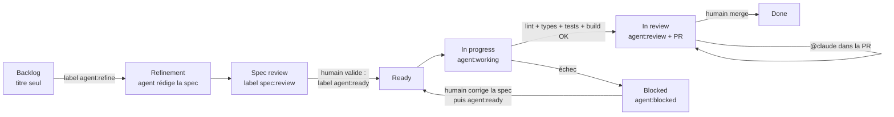

# Workflow agentique : des issues au board, du ticket à la PR

Les issues GitHub servent de specs. Un agent Claude (via
[`anthropics/claude-code-action`](https://github.com/anthropics/claude-code-action))
les transforme en spécifications, les implémente une par une et ouvre une pull
request. **Rien n'est mergé sans validation humaine.**

Même fonctionnement que sur l'API `fanfiction` (backend Django de ce front),
`elearning` et les dépôts Angular `angular-ssr-taiwan` /
`angular-qrcode-restaurant`, adapté à un front Vue 3 qui dépend d'une API
séparée (voir la dernière section).

## Cycle de vie d'un ticket

| Étape                 | Qui     | Déclencheur                                                                              | Ce qui se passe                                                                                                                                                                                                                                                                                                                                                                                                                                                     |
| --------------------- | ------- | ---------------------------------------------------------------------------------------- | ------------------------------------------------------------------------------------------------------------------------------------------------------------------------------------------------------------------------------------------------------------------------------------------------------------------------------------------------------------------------------------------------------------------------------------------------------------------- |
| Raffinement           | Agent   | label `agent:refine` (ou lancement manuel sur une liste d'issues / une épic entière)     | L'agent lit le ticket, l'épic parente, les tickets voisins et le code, puis remplace le corps de l'issue par une spec (contexte, critères d'acceptation, impact technique dont pages, stores, endpoints utilisés et accessibilité, plan de test, hors périmètre, questions ouvertes, estimation). Label → `spec:review`.                                                                                                                                                                             |
| Validation de la spec | **Toi** | —                                                                                        | Tu relis, corriges le corps de l'issue, tranches les questions ouvertes, puis poses `agent:ready`.                                                                                                                                                                                                                                                                                                                                                                  |
| Implémentation        | Agent   | label `agent:ready`, lancement manuel, ou toutes les 3 h (prochain ticket `agent:ready`) | Un ticket à la fois. Branche `agent/issue-<n>-<slug>`, implémentation + tests Vitest, puis vérification dans le navigateur Playwright contre l'app qui tourne (Vite sur `localhost:5173` branché sur l'API Django de démo : SQLite jetable, `seed_demo`), en desktop et en mobile, captures jointes à la PR ; puis par le workflow (ESLint, Prettier et vue-tsc sur les lignes modifiées, `vitest run --changed`, `npm run build-only`). PR ouverte sur `main` avec `Closes #n`, revue demandée à la propriétaire du dépôt. Label → `agent:review`. Si une vérification échoue : PR **brouillon** + `agent:blocked`. |
| Revue                 | **Toi** | —                                                                                        | Tu relis la PR. Pour des corrections, commente `@claude …` (commentaire général, de ligne ou de revue) : l'agent pousse sur la même branche.                                                                                                                                                                                                                                                                                                                        |
| Validation            | **Toi** | merge                                                                                    | La PR ferme l'issue → `Done`.                                                                                                                                                                                                                                                                                                                                                                                                                                       |

Garde-fous :

- Les épics (issues avec sous-tickets) ne sont jamais implémentées directement :
  pose `agent:ready` sur leurs sous-tickets.
- Un ticket `agent:ready` sans section « Critères d'acceptation » repart
  automatiquement en raffinement.
- L'agent ne voit que le ticket, l'épic et les commentaires des mainteneurs
  (le dépôt est public : les commentaires de tiers sont écartés pour éviter
  l'injection de prompt). Il n'a accès ni au réseau ni à `gh` ; il ne peut
  lancer que `scripts/agent/check-changed.mjs`, ESLint, Prettier, vue-tsc,
  `vitest run`, `npm run build-only`, `scripts/agent/api.sh` (qui n'appelle que
  l'API locale) et quelques commandes git en lecture, et le navigateur ne peut
  ouvrir que l'app locale (`http://localhost:5173` et l'API sur `:8000`). Il ne
  peut pas ajouter de dépendance npm.
- L'API de l'agent est le dépôt `delitamakanda/fanfiction` (branche `main`, ou
  la variable `AGENT_BACKEND_REF`), cloné dans `.agent-out/backend/` (ignoré par
  git) et lancé par son propre `scripts/agent/start-app.sh` : base SQLite
  jetable, jamais Postgres ni des données réelles. Les comptes de démo
  (`demo-admin`, staff, `demo-author` et `demo-reader`, mot de passe
  `demo-password-123`), une catégorie, des fanfics publiées et en brouillon,
  des chapitres, un like et un commentaire sont créés par `manage.py
  seed_demo`. L'agent lit le code de l'API pour connaître les endpoints mais
  ne le modifie pas : un besoin côté backend est signalé dans la PR (section
  « API utilisée ») et fait l'objet d'un ticket sur `fanfiction`.
- Toute modification de `.github/` par l'agent est annulée avant le commit, et
  c'est le workflow, pas l'agent, qui commit, pousse et ouvre la PR.

## Le board

`agent-board.yml` range chaque issue dans une colonne du champ **Status** de
ton GitHub Project selon ses labels :

| Label / état    | Colonne (noms acceptés)                                          |
| --------------- | ---------------------------------------------------------------- |
| aucun           | Backlog / Todo (uniquement si la carte n'a pas encore de statut) |
| `agent:refine`  | Refinement                                                       |
| `spec:review`   | Spec review                                                      |
| `agent:ready`   | Ready                                                            |
| `agent:working` | In progress                                                      |
| `agent:review`  | In review                                                        |
| `agent:blocked` | Blocked                                                          |
| fermée          | Done                                                             |

Un déplacement manuel d'une carte sans label agent n'est jamais écrasé. Si une
colonne n'existe pas, la carte reste où elle est (un avertissement est loggé).
Le premier lancement manuel importe tout le backlog existant dans le board.

## Installation (une fois)

1. **App Claude GitHub** : installe <https://github.com/apps/claude> sur ce
   dépôt (ou lance `/install-github-app` dans Claude Code).
2. **Environnement `claude`** : les secrets et variables ci-dessous vivent dans
   l'environnement GitHub `claude` (_Settings → Environments → claude_), pas au
   niveau du dépôt. Les jobs qui les lisent déclarent `environment: claude`.
   Ajoute-y le secret `CLAUDE_CODE_OAUTH_TOKEN` (abonnement Claude, généré
   avec `claude setup-token`).
3. **PR créées par Actions** : _Settings → Actions → General → Workflow
   permissions_ → coche **Allow GitHub Actions to create and approve pull
   requests**.
4. **Labels** : `GH_REPO=delitamakanda/fanfiction-front-vue bash scripts/agent/setup-labels.sh`
5. **Board** :
   - Crée un GitHub Project ou, plus simple, réutilise celui de l'API
     `fanfiction` : front et back sur le même board et ajoute au champ
     **Status** les colonnes : `Backlog`, `Refinement`, `Spec review`, `Ready`,
     `In progress`, `In review`, `Blocked`, `Done`.
   - Enregistre un PAT classique (scopes `repo` et `project`) dans le secret
     `AGENT_PROJECT_TOKEN` — le même que pour tes autres dépôts convient.
   - Ajoute la variable `AGENT_PROJECT_NUMBER` (le numéro dans l'URL du projet,
     `…/users/delitamakanda/projects/<n>`). `AGENT_PROJECT_OWNER` est
     facultative (par défaut : le propriétaire du dépôt).
   - Lance _Actions → Agent – board → Run workflow_ (d'abord avec `dry_run`)
     pour importer toutes les issues.
6. **Modèle** (facultatif) : variable `AGENT_MODEL` (`sonnet` par défaut,
   `opus` pour des tickets plus complexes).
7. **API** (facultatif) : variable `AGENT_BACKEND_REF` pour faire tourner
   l'agent contre une autre branche de `fanfiction` que `main` (par exemple la
   branche d'une PR backend dont le ticket front dépend).

## Utilisation au quotidien

- Raffiner une épic entière : _Actions → Agent – raffinement → Run workflow_,
  champ `epic` = numéro de l'épic, ou champ `issues` = liste (ex. `8,9,10`).
- Implémenter un ticket précis tout de suite : _Actions → Agent –
  implémentation → Run workflow_, champ `issue`.
- Débloquer un ticket `agent:blocked` : corrige la spec ou la PR, retire
  `agent:blocked` et repose `agent:ready`.

## Fichiers

| Fichier                                 | Rôle                                                                                   |
| --------------------------------------- | -------------------------------------------------------------------------------------- |
| `.github/workflows/agent-refine.yml`    | Raffinement des tickets en specs                                                       |
| `.github/workflows/agent-implement.yml` | Implémentation + PR                                                                    |
| `.github/workflows/agent-review.yml`    | Retours de revue via `@claude`                                                         |
| `.github/workflows/agent-board.yml`     | Synchronisation du board                                                               |
| `.github/workflows/ci.yml`              | CI : `npm run build-only` (lancée aussi manuellement sur les branches de l'agent)      |
| `.github/agent/prompts/*.md`            | Instructions des agents (à ajuster librement)                                          |
| `.github/agent/mcp.json`                | Navigateur Playwright MCP (app locale uniquement)                                      |
| `.github/ISSUE_TEMPLATE/spec.yml`       | Formulaire d'issue au format spec                                                      |
| `scripts/agent/prepare-issue.mjs`       | Contexte du ticket fourni à l'agent                                                    |
| `scripts/agent/board-sync.mjs`          | Labels → colonnes du GitHub Project                                                    |
| `scripts/agent/setup-labels.sh`         | Création des labels                                                                    |
| `scripts/agent/start-app.sh`            | API de démo (clonée) sur `:8000` + Vite sur `localhost:5173`                           |
| `scripts/agent/api.sh`                  | Appels à l'API locale avec les comptes de démo                                         |
| `scripts/agent/check-changed.mjs`       | ESLint, Prettier et vue-tsc, bloquants seulement sur les lignes modifiées              |
| `.claude/agents/*.md`                   | Sous-agents : `test-writer`, `ui-reviewer`, `dependency-keeper`                        |

## Différences avec l'API `fanfiction`

- L'agent vérifie ses critères **dans le navigateur** : `start-app.sh` lance
  l'API Django de démo puis Vite sur `http://localhost:5173` (port imposé :
  c'est la seule origine acceptée par le CORS de l'API). Connexion par
  `/login` avec un compte de démo ; captures desktop et mobile jointes à la PR.
  Les icônes Iconify (chargées depuis Internet) n'apparaissent pas sur les
  captures.
- La PR a une section `## API utilisée` au lieu de « Contrat d'API » et
  « Migrations » : le front ne change pas l'API, il signale ce qui manquerait
  côté backend.
- Le dépôt n'est pas encore propre (≈40 erreurs ESLint, ≈14 erreurs vue-tsc,
  ≈85 fichiers non formatés, le seul test unitaire échoue) :
  `check-changed.mjs` ne bloque que sur les erreurs des **lignes** ajoutées ou
  modifiées, ne reformate pas un fichier qui n'était pas déjà formaté sur
  `main`, et les tests lancés sont ceux liés aux changements
  (`vitest run --changed`). La CI reste `npm run build-only` (le build complet
  échoue au type-check sur `main`).
- `npm ci --legacy-peer-deps` est nécessaire (conflits de peer-dependencies).
- La branche par défaut est `main`.
